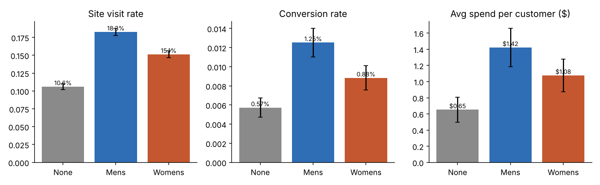
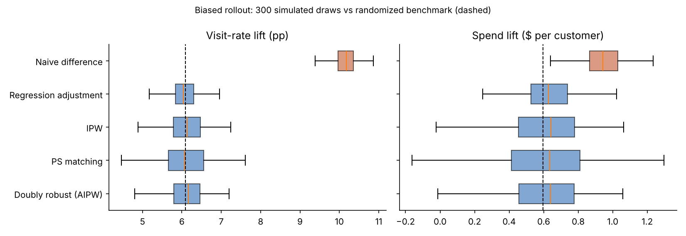

# Email Experiment: Causal Impact and Targeting

Did the marketing email cause the extra sales, and who should get which email? This project answers both questions on the Hillstrom email experiment (64,000 customers, randomly assigned to no email, a men's email or a women's email), and goes beyond the standard A/B readout in three ways:

1. **It stress-tests methods.** The randomized result is the ground truth. The project then breaks the randomization to mimic a typical business rollout and measures which methods recover the truth and which are fooled.
2. **It scores targeting policies in dollars**, with confidence intervals, using off-policy evaluation on the randomized arms.
3. **It reports what did not work.** At a $0.10 email cost, a machine-learning targeting model adds nothing detectable over "send the men's email to everyone". That is the finding, stated plainly.

**Deliverables:** [Executive memo](memo/executive_memo.md) · [Interactive dashboard](dashboard/index.html) (open in a browser; includes a profit simulator) · **[web app with accounts](#the-web-app-email-impact-studio)** · analysis scripts in `src/` · results in `outputs/`.

## Headline results

| Question | Answer |
|---|---|
| Did the emails work? | Yes. Men's email: spend per customer $0.65 to $1.42 (+$0.77, 95% CI $0.49 to $1.06). Women's email: +$0.42 ($0.17 to $0.68). |
| Which email is better? | Men's, by $0.35 per customer in spend (CI $0.03 to $0.66). Women's-only buyers respond equally to both; everyone else prefers the men's. |
| What if the rollout isn't randomized? | The naive comparison overstates the spend lift by 58% (visit lift by 67%). Regression adjustment, weighting, matching and doubly robust estimators recover the truth to within about 6%. |
| Does matching emails to past purchases help? | No: $0.471 vs $0.469 profit per customer for men's email to all. |
| Does an uplift model help? | Not detectably at $0.10 per email: +$0.013 per customer, 95% CI -$0.010 to +$0.039. |
| When does the decision change? | Emailing everyone breaks even at about $0.31 per contact (40% margin). Above that, stop mass sending; customers who bought both lines are the one promising target. |




## The web app: Email Impact Studio

A small website where users create an account, sign in, enter their details and get results. It has three tools and keeps a history per user.

| Tool | User enters | User gets |
|---|---|---|
| **Campaign planner** | List size, gross margin, cost per contact, optional fixed cost, share of customers who bought both product lines | The best email policy, expected profit with a 95% interval, gain versus sending nothing, the break-even cost per contact, a profit-by-cost chart, and plain-language caveats. Policies where the data cannot separate the winner from the runner-up are flagged. |
| **Customer scorer** | Months since last purchase, past-year spend, product lines bought, new or existing, area, channel, margin and cost | Whether to send the men's email, the women's email or nothing, the expected profit gain with a 95% interval, a chart, and what happened to similar customers in the test. |
| **Your data** | A CSV file with one row per customer: a column for the email or treatment group, one or more outcome columns (visited, bought, spend), and optionally a pre-period column, customer attributes, margin and cost | The same kind of official report for the user's own test: a verdict, lift for every group against the control with 95% intervals and adjusted p-values, data checks (group sizes, sample-ratio test, covariate balance), who responds, profit and break-even when revenue is supplied, and notes. |

Every run is saved under the user's account, and each can be opened as a report that can be printed to PDF or downloaded as a standalone file.

The interface is built for every screen: type and spacing scale from phone to large monitor, forms run across the page on a laptop, and wide tables scroll sideways on a phone. It follows a "glass gradient" look: large rounded frosted cards over soft purple, blue and coral colour, gradient number cards, dot-matrix strips, black pill buttons, coloured insight rows and a side menu with the round project logo (`assets/logo-original.png`, cropped by `src/make_logo.py`, also the browser-tab icon). It follows the device's light or dark setting automatically. It uses Calibri throughout (the open-licence look-alike Carlito is bundled for computers without Calibri, see `app/static/fonts/LICENSE-Carlito.txt`), black or white text only, and a faint data-and-money background drawn by `src/make_background.py`. Every finding is a table with a reason beside it instead of a paragraph. The profit chart shades the profit and loss zones, names each line, marks your cost and each policy's break-even cost, and comes with a "How to read this chart" table and an "At your cost" table. "Open report" and "Download report" produce an official A4 document: letterhead and reference number, document control, numbered sections (summary, inputs, results, chart, notes, methodology, glossary), an authorisation block and page numbers. The sign-in page shows the logo, the project title, the login box, then a one-line statement of what the app does. The Evidence page keeps the app menu, so there is no need to go back.

**Your data: how it works and where it stops.** Choose a CSV (up to 20 MB, 300,000 rows, 200 columns; comma, semicolon, tab or pipe separated; a UTF-8 byte-order mark and currency signs are handled). The app reads the header, suggests which column is the group, the control, the outcomes, the revenue and the pre-period value, and shows the first rows so you can correct the choices before running. The analysis is written in plain Python (no pandas or scikit-learn), so the app still needs no packages: it compares each group with the control by the difference in means or proportions, with normal-approximation 95% intervals and Bonferroni-adjusted p-values, applies CUPED when a pre-period column is chosen, runs a sample-ratio check and covariate balance checks, compares segments (numeric attributes in quartiles, adjusting for the number of comparisons), and converts revenue into profit and break-even cost per email. It runs inside the request and takes a few seconds for the 64,000-row Hillstrom file (a test checks it reproduces the +7.7 and +4.5 point visit lifts). Uploaded files are stored for 24 hours, readable only by the user who uploaded them, at most five at a time; the analysis result stays in history. What it does **not** do: it has no uplift machine-learning model and no bootstrap, and the results are causal only if customers were assigned to groups at random (the data checks help spot a broken assignment but cannot prove randomness).

```bash
python app/server.py            # then open http://127.0.0.1:8000 and create an account
python -m unittest discover -s app/tests -v     # 51 tests: auth, password reset, access control, tools, reports, uploaded data, migration
```

No packages are needed to run the app (standard library and SQLite only). Developed and tested on Python 3.13; it should work on 3.9 and later. The model parameters ship in `app/model/model.json`; `python src/05_export_model.py` regenerates them from the data.

**Settings** (environment variables): `HOST`, `PORT`, `DB_PATH`, `SECURE_COOKIES=1` (when served over HTTPS), `ALLOW_REGISTRATION=0` (close sign-ups), `TRUST_PROXY=1` (behind a reverse proxy you control), `BASE_URL` (public address used in reset emails) and `SMTP_*` (outgoing mail). Admin commands: `python app/server.py create-user EMAIL "Full Name"` and `python app/server.py reset-link EMAIL`.

**Putting it online:** see [DEPLOY.md](DEPLOY.md). It covers a Docker Compose setup with automatic HTTPS (`docker-compose.yml`, `deploy/Caddyfile`) and a Render blueprint (`render.yaml`).

**Security measures in place:** password reset by emailed one-time link (tokens stored only as hashes, 60-minute expiry, same response whether or not an account exists, all sessions signed out on reset), scrypt password hashing with per-user salts, constant-time comparison, random session tokens stored only as hashes, `HttpOnly` and `SameSite` cookies, CSRF tokens on every state-changing request including sign-in and sign-up, login throttling (5 failures per 10 minutes per email and per IP), per-user data isolation, output escaping of all user text, a strict content security policy, and parameterized SQL throughout.

**What it does not have, and what to add before real public use:**
- Run it behind HTTPS with `SECURE_COOKIES=1`; the Compose and Render files in this repository do that. The built-in server is fine for a demo or modest use, not for heavy traffic. The deployment files were validated but not built end to end (see DEPLOY.md).
- Password reset needs an SMTP account. Without one, reset links are printed in the server log, which is for local use only.
- There is no email verification at sign-up and no two-factor sign-in.
- SQLite suits one server. Back up `app/data/app.db`.
- The scorer uses a regularized logistic model with 200 bootstrap refits for its intervals, which is simpler than the gradient boosting model in the analysis. Individual scores are noisy by nature; the app says so on every result.
- Results describe one past campaign on one customer list. Users with different customers should treat them as a starting hypothesis and run their own test.

## What is in each part

| Script | What it does |
|---|---|
| `src/01_ab_test.py` | Sample-ratio and covariate-balance checks, effects with confidence intervals for visit, conversion and spend, Holm-adjusted p-values, power and minimum detectable effect, CUPED variance reduction. |
| `src/02_observational.py` | Thins the data so loyal customers are more likely emailed, then compares naive difference, regression adjustment, inverse-probability weighting, propensity matching and doubly robust (AIPW) estimates across 300 random draws. Includes overlap and balance diagnostics. |
| `src/03_uplift_policy.py` | Cross-fitted two-stage uplift model, off-policy profit evaluation with paired bootstrap intervals, uplift-by-decile check, targeting curves, margin and cost sensitivity grid, exploratory segment table, costly-channel scenario. |
| `src/04_build_dashboard.py` | Builds the self-contained dashboard from the saved JSON results. |
| `src/05_export_model.py` | Exports plain-number model parameters (bootstrap group means, per-arm logistic coefficients with 200 refits) for the web app. |
| `src/run_all.py` | Runs everything in order. |

## Run it

```bash
pip install -r requirements.txt
python src/run_all.py
```

The scripts read `data/raw/hillstrom.csv` and write results to `outputs/` and `dashboard/index.html`. Runtime is about two and a half minutes.

## Design decisions worth knowing

- **Why a stress test instead of difference-in-differences.** The dataset has no time dimension, so difference-in-differences does not apply. Rather than invent a before-and-after period, the biased rollout is built by thinning the randomized data, which keeps a trustworthy benchmark.
- **Flexible covariates matter.** My first pass used only linear covariate terms and left 4% to 14% residual bias on some outcomes. Treating recency and spend band as categories removed it.
- **Why a two-stage uplift model.** Only about 580 customers converted, so models of conversion are mostly noise. The model predicts visits (18% base rate), then applies conversion per visit and spend per converter by arm.
- **Off-policy evaluation.** Each arm had probability 1/3, so a policy's profit is the average among customers whose random arm matches the policy's choice (self-normalised inverse-propensity weighting), computed on out-of-fold predictions.
- **Model choice was not tuned on the evaluation.** The gradient boosting model was specified in advance; a logistic model is reported as a check. Both are shown in the policy table.

## Assumptions and limitations

- **Margin and email cost are assumptions** (40% and $0.10). The sensitivity grid covers 20% to 60% margin and $0.05 to $2.00 per contact.
- **Two-week outcome window.** Long-run value, fatigue and unsubscribes are not measured.
- **The biased rollout is engineered**, and selection depends only on observed traits. Real data often has unobserved confounding that no adjustment can fix.
- **Segment results are exploratory.** Ten subgroups were compared without pre-registration.
- **Single campaign.** Results may not transfer.

## Data

Hillstrom, K. (2008). *The MineThatData E-Mail Analytics and Data Mining Challenge.* Twelve columns including recency, past-year spend, product-line flags, channel, the assigned email arm, and the outcomes `visit`, `conversion` and `spend`. The CSV in `data/raw/` is the public dataset, unmodified.

## What I would do next

- Replace the assumed margin and cost with real figures and rerun the sensitivity grid.
- Run a larger confirming test on the bought-both segment.
- Add sequential testing so that future campaigns can stop early.
